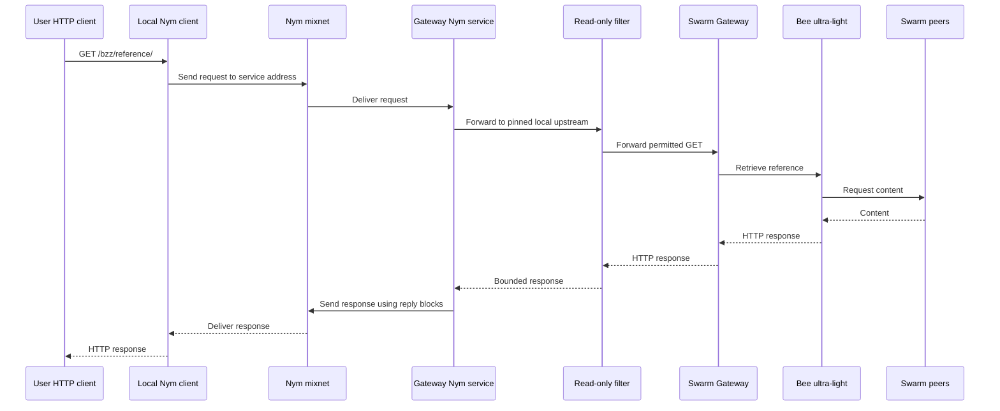

# Architecture

The intended prototype offers our Swarm gateway as a Nym-addressed service. The Nym transport and end-to-end request are still being verified.

```mermaid
flowchart LR
    U[User HTTP client] -->|HTTP on loopback| C[Nym RPC client\nraw TCP listener]
    C <-->|Nym mixnet mainnet\nanonymous replies| S[Nym RPC server\npersistent service address]
    S -->|pinned TCP upstream| F[Read-only HTTP filter\n127.0.0.1:18080]
    F -->|HTTP on loopback| G[Our Swarm Gateway\n127.0.0.1:13000]
    G -->|private Docker network| B[Our Bee ultra-light node]
    B <-->|Swarm peer protocol| P[Swarm mainnet peers]
```

The gateway sees a request from the local filter, not the user's IP. The Nym entry gateway sees the user's network address; application data can still identify a user. This diagram does not claim end-to-end anonymity has been demonstrated.

The current filter accepts 64-character hexadecimal references and caps responses at 2 MiB. Bee ultra-light downloads depend on peers' free-tier limits. The service Nym identity must persist, and its address must be distributed to users separately.
